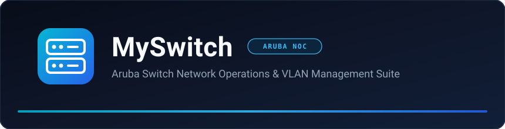

<p align="center">
  
</p>

<p align="center">
  <b>MySwitch</b> is a desktop Network Operations Center (NOC) &amp; configuration manager built specifically for <b>Aruba Switches</b> (AOS-CX, AOS-S / ProCurve, and Instant On).
</p>

<p align="center">
  
  
  
</p>

<p align="center">
  <a href="https://github.com/kepinandreew/switchAruba/releases"><b>Releases</b></a> ·
  <a href="https://github.com/kepinandreew/switchAruba/actions"><b>Builds (Actions)</b></a>
</p>

---

## Installation

### macOS (Apple Silicon M1 / M2 / M3 / M4 & Intel)
1. Download **`MySwitch-*-macos-universal.zip`** from [**Releases**](https://github.com/kepinandreew/switchAruba/releases/latest), unzip it, and drag **`MySwitch.app`** to **`/Applications`**.
2. Because the app is not notarized with a paid Apple Developer ID certificate, macOS Gatekeeper on Apple Silicon may show *"MySwitch is damaged and can't be opened"* or *"Apple could not verify MySwitch"*. Clear the browser quarantine flag once in **Terminal**:
   ```bash
   xattr -cr /Applications/MySwitch.app
   ```
3. Open **MySwitch** from Applications.

### Windows 10 / 11 (64-bit)
1. Download **`MySwitch-*-windows-x64.zip`** from [**Releases**](https://github.com/kepinandreew/switchAruba/releases/latest), unzip, and run **`MySwitch.exe`** (if SmartScreen appears, click **More info → Run anyway**).

---

## Key Features

- **Real-Time Fleet Dashboard & KPI Cards** — Instant overview of online/offline switches, critical alerts, warnings, and interactive numbered port faceplates (`S / M / L / XL` zoom).
- **Direct Interactive Port VLAN Configuration** — Click ports directly on the visual faceplate or select rows in the Ports table to configure **Access (Untagged)** or **Trunk (Native + Tagged)** VLANs without writing CLI commands manually.
- **Bulk IP Range Discovery & Auto-Cleanup** — Add entire subnets or IP ranges (e.g. `10.0.0.2 - 10.0.0.50`), sort switches naturally by IP, and remove unreachable hosts in one click with **Delete offline**.
- **Port Naming & LLDP Auto-Discovery** — Rename ports directly from the table or auto-populate port descriptions from connected LLDP neighbors.
- **Network Topology Map & Client Locator** — Interactive LLDP/CDP topology map and network-wide MAC address path finder.
- **Safe Batch Firmware Management** — Upload firmware via SSH/SFTP (AOS-S) or HTTPS REST (AOS-CX) with bottom-up topology reboot ordering and per-switch firmware hold locks.

---

## Building from Source

```bash
wails build -clean -ldflags "-X main.Version=1.0.21"
```
